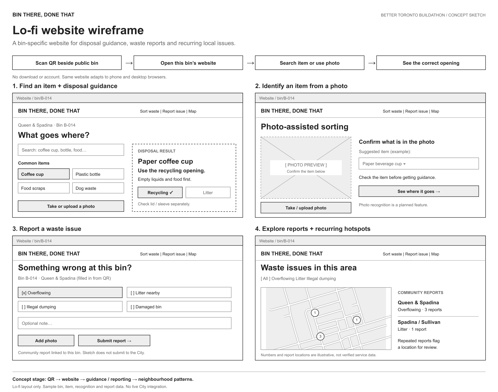

# Bin There, Done That

**Scan a public-bin QR code. Open its website. Find where your waste goes.**

A Toronto waste-guidance and reporting website concept for the Better Toronto Buildathon. Each QR code identifies a specific public bin, so residents can get guidance for the openings actually available there, report a problem and explore recurring issues nearby. The website works in a phone or desktop browser, with no download or account.

## Lo-fi sketch

[View full-size sketch](docs/lofi-sketch.png) · [Editable SVG](docs/lofi-sketch.svg) · [Website preview source](index.html)

## The problem

Residents can be unsure which public-bin opening to use, especially for items with several parts. Overflowing bins, litter and illegal dumping can also recur without a clear picture of where issues are being reported. This concept connects disposal guidance and community reports to the same bin and location.

## How it would work

1. **Scan the bin's QR code.** Its webpage opens with the bin and location already selected.
2. **Find an item.** Search common items or take/upload a photo and confirm what it shows.
3. **Get disposal guidance.** See the appropriate opening and preparation steps, such as emptying a cup and checking its lid separately.
4. **Report an issue.** Flag an overflowing bin, nearby litter, illegal dumping or damage, with an optional note or photo.
5. **Explore local patterns.** View reports on a map and identify locations receiving repeated reports.

## What is included now

This repository contains a **lo-fi concept sketch**, not a production service:

- A responsive, clickable website preview with item selection and example disposal guidance.
- A photo-upload preview and manual item confirmation.
- A simulated issue-reporting flow linked to a sample bin.
- A map with sample reports and filters.
- A submission-ready wireframe image.

Photo recognition is illustrated, not implemented. Reports are held only for the current preview session and are not sent to the City or 311. Bin identities, report locations and counts are examples. Uploaded images remain in the browser preview; there is no server upload in this sketch.

## Open the preview

Download or clone this repository, then open **`index.html`** in a browser. No installation or build step is needed. Use the top navigation to try **Sort waste**, **Report an issue** and **Area map**. The footer also links to the QR-sticker concept.

The illustrative QR code is a placeholder; it does not open a deployed version of this website.

## Planned hackathon build

- Bin-specific QR URLs and an initial bin/opening dataset.
- Broader disposal guidance based on current public-space rules.
- Photo-assisted identification with confirmation and a manual fallback.
- Stored community reports and a map of recurring issues.

Potential interventions would be reviewed using community reports; a report alone would not verify a problem or create a City work order.

## References

- [City of Toronto: Recycling Right in Public Spaces](https://www.toronto.ca/services-payments/recycling-organics-garbage/recycling-right-in-public-spaces/) — source for the example disposal guidance.
- [Toronto Open Data: Toronto Centreline](https://open.toronto.ca/dataset/toronto-centreline-tcl/) — source for the street geometry used in the map preview.

Independent hackathon concept; not affiliated with the City of Toronto.
