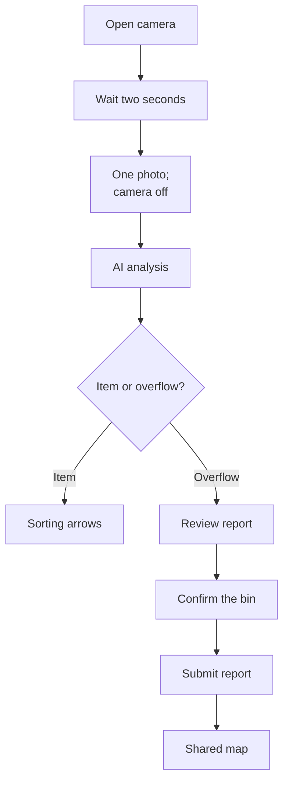
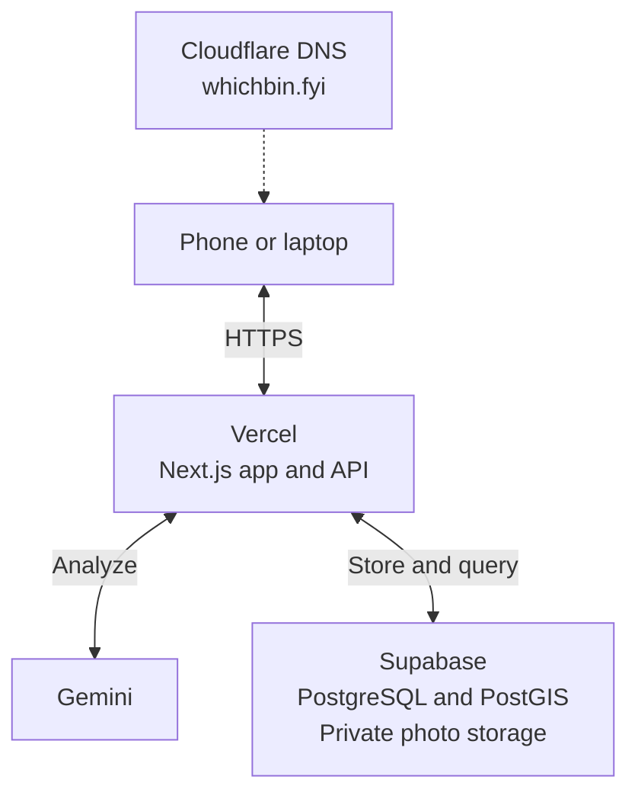

# WhichBin

### Point. Sort. Done.

A camera-first web app that helps people in Toronto sort everyday waste, report overflowing bins, and see what is happening around them.

**[Visit WhichBin](https://whichbin.fyi)** · **[Open the dashboard](https://whichbin.fyi/dashboard)** · **[Try the camera](https://whichbin.fyi/scan)**

[Why we are building this](#why-we-are-building-this) · [How it works](#how-it-works) · [Run locally](#run-locally) · [Technical overview](#technical-overview) · [Project guides](#project-guides)

## Why we are building this

Knowing what to throw away is not always the same as knowing **where it belongs**. One takeaway drink can have a cup, a lid, a straw, and leftover food or liquid. Each part can need a different disposal decision.

At the same time, an overflowing public bin can be obvious to everyone walking past it and still have no recorded report or visible follow-up.

WhichBin brings those two problems into one experience: **help people sort waste at the moment of disposal, and make local bin problems easier to report and follow.**

| What we want to achieve     | How the app supports it                                                       |
| --------------------------- | ----------------------------------------------------------------------------- |
| Fewer sorting mistakes      | Identify an item and show a destination for its individual parts.             |
| Easier reporting            | Turn an overflowing-bin photo into a report that is already partly filled in. |
| Better visibility           | Put shared reports and bin locations on a searchable map.                     |
| Fewer gaps in the inventory | Let residents add a photographed bin where coverage is missing.               |
| Clearer follow-up           | Track open issues, mark resolved cases, and keep their history.               |

These are the project's goals. Its real effect on sorting accuracy and neighbourhood cleanliness still needs to be measured through pilots.

## How it works

### 1. Point at an item

Open WhichBin on a phone and allow camera access. Once the camera is ready, the app waits **two seconds**, takes **one photo**, and switches the camera off.

The AI identifies the visible item and its parts. Arrows connect those parts to disposal labels on the captured photo. For example, a drink can receive separate guidance for the cup body, lid, and straw. **Retake photo** starts another attempt.

### 2. Point at an overflowing bin

When the photo supports an overflowing-bin result, the app opens a report page with the photo, issue type, capture time, and visible evidence already filled in.

Location access helps suggest the nearest registered bin. You can check that suggestion or search by street or bin ID, then **submit the report yourself**. Detecting overflow prepares a report; it does not publish one without confirmation.

### 3. Explore and contribute

On a laptop, the website opens the dashboard. On either device, you can:

- Search streets and bin locations, and switch between inventory, bin-density, and report-density views.
- Select a map bin to see its details, current issues, and history, or report an issue manually.
- Add a missing bin using a photo and your location, within a designated area. A nearby existing or pending bin blocks duplicate additions.
- Mark an issue resolved or withdraw your own mistaken report. Resolved history is retained.



No clear result? Retake the photo or use manual reporting.

### What do the AR arrows mean?

The current experience is **photo-based augmented guidance**: boxes, numbered labels, and arrows are drawn over the exact photo that was analyzed. The labels stay attached to the correct image positions when the screen changes size.

The arrows explain **which disposal category a part belongs in**. They do not track a moving object in live video or point to the physical opening of a nearby bin. Continuous tracking and world-anchored AR are possible future work.

The two-second countdown is the capture delay. AI processing takes additional time and depends on the connection and model; a fixed response time is not guaranteed.

## Technical overview

The website, AI connection, database, and image storage have different jobs:



Cloudflare manages where the domain points. **Vercel runs the application**, so the public website does not depend on a laptop or a temporary tunnel staying online. The browser talks to the app's own API; the server handles access to Gemini and Supabase.

| Technology                     | Its job, in plain language                                                                             |
| ------------------------------ | ------------------------------------------------------------------------------------------------------ |
| **Next.js, React, TypeScript** | Build the screens and the server endpoints behind them.                                                |
| **Gemini**                     | Inspect a photo for items, component locations, and visible bin conditions. The model is configurable. |
| **Sorting rules**              | Map recognized items and materials to disposal guidance, using the app's local rule catalog.           |
| **PostgreSQL**                 | Store connected records such as bins, reports, and cases.                                              |
| **PostGIS**                    | Add location-aware database tools, including nearest-bin searches and area checks.                     |
| **Supabase**                   | Manage PostgreSQL and private photo storage. Production uses the Free plan.                            |
| **MapLibre and OpenFreeMap**   | Draw the interactive map and its underlying basemap.                                                   |
| **Vercel Hobby**               | Host the application. Gemini API usage is billed separately by Google.                                 |

### What gets stored?

| Information                                                   | Where it lives                                                                        |
| ------------------------------------------------------------- | ------------------------------------------------------------------------------------- |
| City and community bins, designated areas, reports, cases     | Supabase PostgreSQL, with PostGIS location fields.                                    |
| Report and community-bin evidence photos                      | Private Supabase Storage in production.                                               |
| Sessions, private notes, recovery information, image metadata | Private database records, accessed through the server.                                |
| Keys and passwords                                            | The developer's ignored `.env.local` or Vercel's private server environment settings. |

The production scanner sends one selected still to Gemini for analysis; it does not upload continuous video. Its ordinary sorting preview does not retain the image in Supabase. A confirmed photo report saves its evidence privately. Accepted evidence defaults to **seven days** of retention; expired images are blocked immediately, with scheduled cleanup removing stored objects.

Report photos are not a public photo feed. Public dashboard responses omit private evidence, notes, recovery secrets, and session identifiers. See the [storage and privacy details](docs/cloud-storage.md) for the full lifecycle, including temporary evidence used by other endpoints.

### Reports, cases, and bins are different

- A **bin** is a physical location in the inventory.
- A **report** is one submitted observation about a problem.
- A **case** groups observations belonging to the same issue at that bin.

For example, three reports about one overflowing bin can mean **three reports, one open case, and one affected bin**. Resolving the case removes its observations from the active counts and highlights, while keeping accepted history in the bin's details. Withdrawing a report retracts that observation rather than deleting everyone else's reports.

## Run locally

You can explore the app and work on its UI **without production credentials**.

### Before you start

Install **Node.js 24.x** and **Git**. npm is included with Node.js. Check your Node version with `node --version`.

### 1. Download the project and install dependencies

```sh
git clone https://github.com/amEya911/Bin-There-Done-That.git
cd Bin-There-Done-That
npm ci
```

The included Toronto map data is already in the repository. No dataset download or import is needed for this first run.

### 2. Create your local settings

On a **fresh checkout**, copy the template:

```sh
cp .env.example .env.local
```

If `.env.local` already exists, edit that file instead of replacing it.

Open `.env.local` in your editor and change these two lines:

```dotenv
DATA_BACKEND=sqlite
TRASHME_DATA_DIR=.data/local-dev
```

SQLite is a small database stored on your computer. The app creates it automatically. This keeps development data separate from the shared Supabase database. Leave the Supabase placeholders unused in this local mode.

**Want AI scanning too?** Add your own Gemini key after `GEMINI_API_KEY=` in the same private file. The model setting is shown in `.env.example`. Without a working key, the map and manual workflows remain usable, but the app will not invent an AI result.

### 3. Start the app

```sh
npm run dev
```

Open **[localhost:3000](http://localhost:3000)**. The terminal will show a different port if 3000 is already in use.

- **[Dashboard](http://localhost:3000/dashboard):** explore the map and reports.
- **[Camera](http://localhost:3000/scan):** try the scanner with a configured Gemini key.
- **[Camera-off view](http://localhost:3000/scan?camera=off):** inspect the screen without starting the camera.

Operator tools require a private, server-only `ADMIN_PASSWORD` setting. Visitors never configure AI keys or administrator access through the website.

A phone needs a trusted **HTTPS** address and camera permission. `localhost` on your phone refers to the phone itself. Use the live website or a separately configured HTTPS development tunnel when testing on a physical phone.

### Using Supabase for development

The deployed app already uses Supabase. Contributors should use local SQLite or a separate development Supabase project unless a maintainer supplies an approved shared development connection.

For cloud configuration, use the server-only fields in [`.env.example`](.env.example) and follow the [cloud storage guide](docs/cloud-storage.md). SQL migrations live in [`supabase/migrations/`](supabase/migrations/). The existing migration script is a guarded SQLite-to-cloud transfer tool, not a normal step when starting the app.

## Find your way around the code

```text
app/                    Pages and API endpoints
components/             Camera, dashboard, map, forms and shared UI
lib/                    AI adapter, sorting rules, reporting and storage logic
public/data/            Toronto map data and its source manifest
supabase/migrations/    Database structure, spatial tools and permissions
scripts/                Data preparation, maintenance and training tools
tests/                  Automated checks
docs/                   Detailed architecture and operating guides
training/               Experimental model specifications and training notes
```

Good starting points: [`components/camera-scanner.tsx`](components/camera-scanner.tsx) for the camera flow, [`lib/vision.ts`](lib/vision.ts) for the Gemini prompt and response handling, [`lib/rules.ts`](lib/rules.ts) for disposal guidance, and [`components/ar-overlay.tsx`](components/ar-overlay.tsx) for the arrows.

The repository and some internal identifiers retain earlier names, including **Bin There Done That** and **TrashMe**. The public website address is **whichbin.fyi**.

### Main pages

| Page            | Purpose                                                                        |
| --------------- | ------------------------------------------------------------------------------ |
| `/`             | Opens the scanner on supported mobile browsers and the dashboard on computers. |
| `/scan`         | Capture one photo, see sorting arrows, or prepare a report.                    |
| `/report`       | Review a captured overflow report before submitting.                           |
| `/dashboard`    | Explore bins, heatmaps, and reported issues.                                   |
| `/bins/:id`     | View a bin, report an issue, or review its history.                            |
| `/bins/new`     | Add a photographed bin in an allowed area.                                     |
| `/manage/cases` | Read public case details; signed-in operators can access protected tools.      |
| `/about`        | Read about the project and its data.                                           |
| `/receipts/:id` | Open a report receipt with the original browser session or recovery link.      |
| `/manage/bins`  | Administrator-only bin inventory management.                                   |

The retired `/setup`, `/scan/test`, `/manage/demo` and `/demo/...` pages have been removed and return 404. Demo API endpoints are also retired. Operator and API endpoints are described in the [API guide](docs/api.md).

## Useful commands

| Command                | What it does                                                                                   |
| ---------------------- | ---------------------------------------------------------------------------------------------- |
| `npm run dev`          | Start the development server.                                                                  |
| `npm test`             | Run automated checks using isolated test data.                                                 |
| `npm run build`        | Build the app for production, including TypeScript checks.                                     |
| `npm run typecheck`    | Check TypeScript separately after development or a build has generated route types.            |
| `npm start`            | Run a completed production build locally.                                                      |
| `npm run import:bins`  | Regenerate the public map files from the included City GeoJSON; it does not populate Supabase. |
| `npm run data:cleanup` | Remove expired evidence and temporary data from the configured backend.                        |
| `npm run db:backup`    | Write a private data backup under ignored `.data/`.                                            |

Maintenance commands act on the configured backend. Run them only against the environment you intend to manage. For deployment, domain settings, and the daily cleanup job, see [Vercel hosting](docs/deployment-vercel.md).

## Current scope and next steps

**Implemented:** one-photo Gemini analysis, component arrows, confirmed photo reports, shared maps, manual reporting, community bin additions, case resolution, and protected evidence storage.

**Next to validate:** recognition accuracy on real Toronto scenes, false overflow detections, disposal-rule coverage, GPS matching on physical phones, and response times across networks. The project does not claim measured improvements in recycling or guaranteed detection accuracy yet.

**Experimental:** custom YOLO/RF-DETR and on-device inference work lives alongside the application. Those models are not the active production scanner. See [training progress](training/README.md) for datasets, annotation provenance, results, and model limitations.

Sorting labels and rule coverage are maintained in the app. Project-specific choices, including its current straw policy, are recorded separately from Toronto-sourced rules. Public reports are community observations; the app does **not** automatically submit them to Toronto 311 or claim City verification of community additions.

## Common questions

| Question                                    | Answer                                                                                                                      |
| ------------------------------------------- | --------------------------------------------------------------------------------------------------------------------------- |
| Why will the camera not open?               | Check camera permission and use localhost on your computer or trusted HTTPS on your phone.                                  |
| Why is the AI unavailable?                  | Check your private Gemini key, configured model, and provider quota or billing. Manual reporting remains available.         |
| Why is the suggested bin wrong?             | GPS accuracy varies. Check the displayed distance and search for the correct street or bin before submitting.               |
| Why can I not add a bin?                    | The location must be in a designated area, fresh and accurate enough, and at least 15 metres from another non-rejected bin. |
| Does the website stop when a laptop closes? | The deployed Vercel website keeps running independently. A local development server or laptop tunnel does not.              |

## Data and attribution

The included [City of Toronto litter-receptacle dataset](https://open.toronto.ca/dataset/street-furniture-litter-receptacle/) contains **10,457 records** in this snapshot: **9,822 existing** and **635 temporarily removed** bins. Removed assets are excluded from active matching. Community additions are labeled separately and receive no invented City asset ID.

Map attribution remains available in the interface: [OpenFreeMap](https://openfreemap.org/), [OpenMapTiles](https://www.openmaptiles.org/), and [OpenStreetMap contributors](https://www.openstreetmap.org/copyright). Reference photographs used by tests retain their [attribution](public/images/ATTRIBUTION.md). Data, photos, and experimental models retain their respective source licences.

## Project guides

| Guide                                                         | Read it when you want to...                                    |
| ------------------------------------------------------------- | -------------------------------------------------------------- |
| [Cloud data and storage](docs/cloud-storage.md)               | Understand PostgreSQL, PostGIS, private images, and retention. |
| [Vercel deployment](docs/deployment-vercel.md)                | Manage hosting, the custom domain, and server settings.        |
| [API reference](docs/api.md)                                  | Work on the endpoints and request formats.                     |
| [Architecture and AR design](docs/hackathon-review-and-ar.md) | Explore the design rationale and planned improvements.         |
| [Training workspace](training/README.md)                      | Work on datasets, annotation, and experimental models.         |

**Contributing?** Start with local setup, make a focused change, and run the relevant checks. Keep API keys, passwords, `.env.local`, `.data/`, private report links, and downloaded training images out of commits. Use [`.env.example`](.env.example) for configuration names only.
