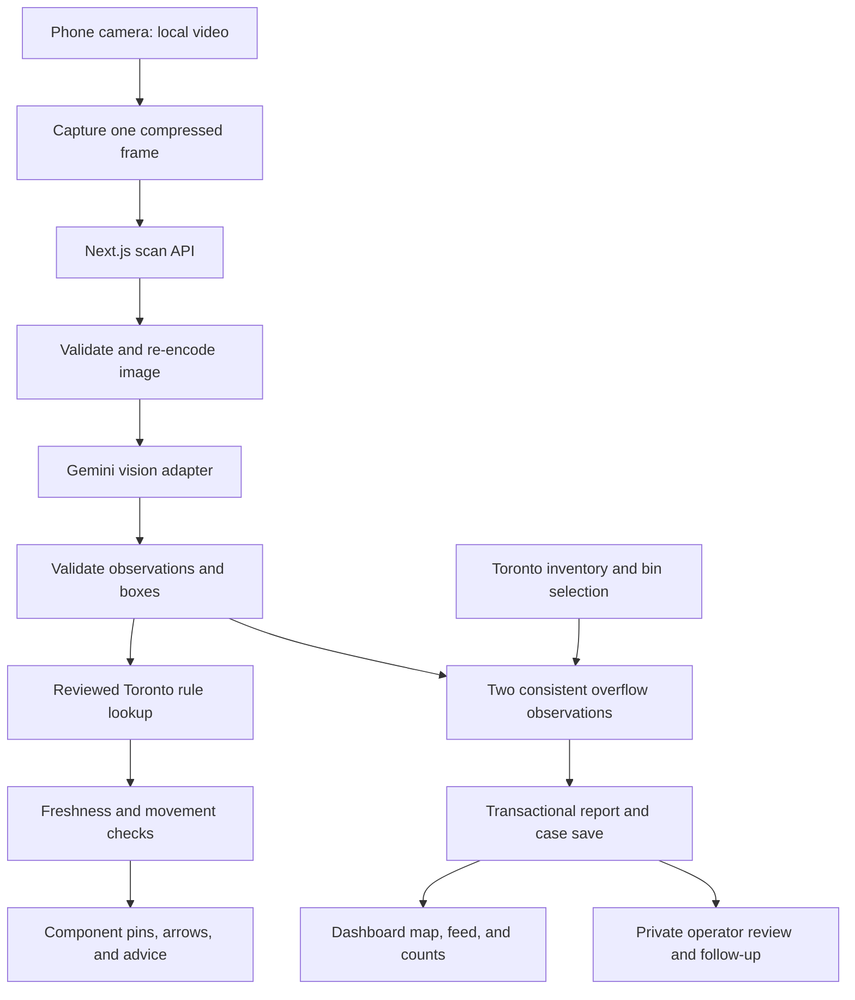

# TrashMe.fyi — Project review and AR architecture

Reviewed October 22, 2026. This describes the local implementation, the improvements made during this review, and the remaining validation work. It does not claim a successful live AI or physical-phone rehearsal.

## 1. Product direction

The strongest demonstration is one connected loop: **notice a waste item or an overflowing bin → give a useful answer → record a location-specific observation → show the change on the dashboard → follow through on the case**.

The product already has three useful foundations: a real Toronto asset inventory, server-validated reporting, and private operator workflows. The highest-value improvements are reliable camera feedback and clear evidence of a saved result. Adding more frameworks or a chatbot would contribute less to this core experience.

Use browser camera overlays for the current release. Keep one web application that phones can open directly and laptops can use as a dashboard. Treat persistent 3D navigation and guidance to physical bin openings as later capabilities with their own localization requirements.

## 2. What the review found and changed

| Finding                                                              | Effect                                                                                                      | Change made                                                                                                                                                                 |
| -------------------------------------------------------------------- | ----------------------------------------------------------------------------------------------------------- | --------------------------------------------------------------------------------------------------------------------------------------------------------------------------- |
| A cloud response could return after the view changed                 | Labels could refer to an object no longer in front of the camera; old observations could enter confirmation | Compare the captured image's small pixel sample against the current view, remember intervening movement, and reject moved or over-age live results                          |
| Pausing did not invalidate an in-flight camera response              | A pending response could continue the automatic reporting flow after pause                                  | Pause, mode changes, manual reporting, bin selection, camera stop, and tab hiding invalidate pending results; relevant requests are aborted                                 |
| Component tags had no precise leader lines and could overlap         | It was unclear which advice belonged to the cup body, lid, or straw                                         | Numbered component pins, arrow leaders, bounded label placement, and corresponding numbered guidance cards; show up to three image callouts and keep all advice in the list |
| Uploaded photos had no annotations                                   | Slow-network/photo fallback lost the main visual explanation                                                | Map annotations to the uploaded photo's contained image rectangle as well as live video                                                                                     |
| Overall uncertainty could conflict with confident component fields   | An unusable image could still produce a positive sorting recommendation                                     | Suppress component advice for non-item scenes and downgrade component certainty for low-certainty or defective images                                                       |
| Report validation relied partly on model normalization               | Defective stored observations were not explicitly rejected at every reporting boundary                      | Require visible evidence and no quality defects in both observations; reject future evidence; require an active physical bin for automatic reports                          |
| Manual submit retries generated a new key each time                  | An uncertain network response could lead to duplicate reports on retry                                      | Preserve the manual submission's idempotency key through retries and guard concurrent submissions                                                                           |
| Idempotency lookup did not check reporting scope                     | Reusing a key could return a report from another scope                                                      | Reject reuse across public/demo reporting areas                                                                                                                             |
| Dashboard emphasized the feed but not the most reported assets       | Repeated reports were harder to connect to a location                                                       | Add the top three reported locations for the selected window, with report and case counts and direct map selection                                                          |
| Some advice linked to a general source rather than the relevant rule | Users could not easily verify item-specific advice                                                          | Link supported recyclables to Toronto's recycling guidance and unknown materials directly to Waste Wizard                                                                   |

The orange, peach, and charcoal camera palette is preserved. A blue recycling annotation communicates the disposal stream. No fabricated AI detections, public reports, or percentage-accuracy claims were added.

## 3. How the architecture connects

**Browser:** React manages the camera, location selection, local movement sampling, uploaded photos, and visual overlays. The camera video remains on the phone. Selected JPEG frames are sent to the server for analysis.

**Application server:** Next.js handles session scope, image decoding, inference requests, rule lookup, report validation, idempotency, private evidence access, and case operations. The Gemini key remains server-side.

**Model:** The configured adapter uses Gemini Interactions with `gemini-3.8-flash`, a structured JSON response, and Zod validation. Its job is to observe visible components, material uncertainty, overflow evidence, and image coordinates. It does not decide a Toronto collection rule or submit a report itself. Google's [image understanding documentation](https://ai.google.dev/gemini-api/docs/image-understanding) describes normalized object boxes, which the application converts into screen coordinates.

**Rules:** A reviewed subset maps supported observations to recycling, organics, garbage, or a material check. The scope is Toronto public-space guidance. Lids and straws are not assigned a stream just because the cup body is recognized. A reported material is still a model observation, not laboratory identification.

**Persistence:** SQLite transactions and private server files are the active local architecture. The inventory contains 10,457 source assets, with 9,822 listed as existing. Supabase/PostgreSQL/PostGIS, managed identity, private object storage, and shared rate limits remain the cloud deployment phase. This build requires a persistent filesystem.

## 4. What the AR actually does

### Opening the camera

On a phone, the root route chooses `/scan`; a laptop chooses `/dashboard`. The scanner requests a rear camera without microphone access. The browser still controls permission. A phone needs a reachable, trusted HTTPS origin; `localhost` on a phone refers to that phone. See [camera permission and secure-context requirements](https://developer.mozilla.org/en-US/docs/Web/API/MediaDevices/getUserMedia).

The camera-off preference remains in effect until explicitly restarted. Navigation releases tracks. Hidden tabs stop analysis. Turning the camera off also invalidates pending analysis and stops the location watch.

### Looking at a coffee cup

1. The browser draws the current camera image to a canvas and sends a compressed JPEG to `/api/scan`. There is only one client inference request in flight.
2. The server decodes, rotates, resizes, and re-encodes the image. It sends the sanitized frame to Gemini.
3. Gemini returns visible observations. A cup body, lid, and straw have separate boxes only if they are visible. No unseen component is invented.
4. The rule lookup produces advice. A confidently identified supported paper beverage cup body receives the reviewed empty-first recycling guidance. Unknown lid/straw materials receive a material-check instruction and a Waste Wizard link.
5. The client checks the response against the view it captured. If the camera moved substantially while waiting, it discards the live result, even if the camera later returns to a similar view.
6. Each component gets a numbered pin. A leader arrow connects that pin to its label. The same number appears beside the full instruction below the camera.

The coordinate conversion is `scale = min(surfaceWidth/imageWidth, surfaceHeight/imageHeight)`. The drawn image is centered; its letterboxing is excluded. Normalized component coordinates are scaled within that rectangle. The rectangle is recomputed after resize or source-image changes. Photos use their actual dimensions.

This is **image-aligned 2D AR**. It augments the camera view with recognized information. It does not currently estimate camera pose, depth, a ground plane, or a stable world anchor. Boxes are refreshed through new observations; they are not continuously tracked at video frame rate. [WebXR](https://developer.mozilla.org/en-US/docs/Web/API/WebXR_Device_API) is a separate route to spatial experiences and has limited browser availability.

### Movement, latency, and clutter

Live results older than 12 seconds are rejected. Displayed live annotations expire after at most four seconds and disappear after substantial scene change. These are current engineering thresholds, not calibrated accuracy guarantees. The movement comparison is a coarse 16 × 16 RGB check; small motion, exposure changes, flicker, and similar-looking objects remain reasons for field testing.

The scanner waits 2.2 seconds after a request finishes before its next scheduled analysis. That is **not** 2.2-second inference latency. Two-observation reporting takes both inference times, the gap, database save, and the next dashboard refresh. Repeatedly analyzing an unchanged item currently consumes requests; a later cost improvement should reuse stable results or add an on-device tracker with explicit reacquisition.

If the connection is slow, a photo gives the annotations a stationary reference. Uploaded photos always require explicit report submission and do not count as two live overflow observations.

### Arrows toward actual bin openings

The current arrows identify components on the screen. They cannot reliably point to a physical recycling opening just because GPS found a nearby bin. GPS identifies an approximate asset location; it provides no camera-relative opening geometry.

A later physical-placement feature would need verified opening labels and positions. A practical controlled pilot could place known visual markers beside openings, associate each marker with a bin and stream, and use the detected marker's corners to place a 2D arrow on that plane. Marker loss must hide the arrow. A marker-free spatial version needs opening detection plus pose/depth/tracking support and a broader hardware validation effort. Neither capability is claimed by the current implementation.

## 5. Overflow reporting from camera to map

An automatic report requires two distinct server-held camera scans from the same session and scope. They must be fresh, separated by 0.7–20 seconds, show high-certainty overflow with visible evidence, have no quality defects, overlap sufficiently, and represent a similar scene. The image hashes must differ so replaying an identical frame is rejected. Two frames are a consistency check, not independent human corroboration.

Overflow means waste visibly protrudes from or spills out of the bin opening. A closed bin, unrelated nearby litter, or a guessed fill percentage does not satisfy that definition.

Location is resolved separately. GPS can choose a bin only with the configured accuracy and ambiguity thresholds; otherwise the user selects the actual bin. Without a resolved bin the automatic report waits. A manual unmatched observation remains available for missing inventory. Operators can register a physically existing bin inside a designated polygon, review near-duplicates, and approve it with community provenance.

`POST /api/reports` rechecks the evidence, scope, bin, and idempotency key, then saves the report and case together. Only a successful save produces the receipt. Continued same-session reporting of the same unresolved bin is suppressed for 30 minutes. The dashboard refreshes from stored state every 3.5 seconds.

Three accepted reports about one continuing issue can produce **3 reports, 1 case, 1 affected bin**. A later recurrence after completion can open another case. Report volume and bin-density heatmaps describe different things; observation coverage is not a citywide cleanliness measurement. No automatic Toronto 311 submission occurs.

## 6. The projector demonstration

1. Configure operator access and a working Gemini connection. Establish trusted HTTPS access from the physical phone.
2. Create a private demo session and select the intended Toronto bin. The server pins that asset to the session; stage GPS does not choose an unrelated nearby asset.
3. Open the session's private scanner QR on the phone and the presentation/dashboard on the laptop.
4. First show an ordinary object or empty scene. It must not save an overflow report. Then hold a real item in view to demonstrate component guidance.
5. Display the overflow photograph. The phone camera must actually see it and produce two valid observations. Showing the image on the projector alone does not trigger a report.
6. Show the saved receipt, dashboard increment, and highlighted bin. Hold the scene longer to demonstrate duplicate suppression.
7. Show the operator case and how work completion and a recheck are recorded separately.

The bundled reference photo is labeled Hamburg, 2005. It is a recognition target, not evidence of a current Toronto incident. Demo reports stay in the private demo scope. Layout-test fixtures likewise do not establish AI recognition success.

## 7. Validation and remaining priorities

**Completed:** 23 automated tests pass; TypeScript and an optimized production build pass. Tests cover normalized guidance uncertainty, camera image containment, late/moved results, callout collisions, defective/future evidence, physical-bin requirements, scoped idempotency, and the existing reporting/case workflows.

**Browser checks:** camera-off scanner and manual item lookup; phone-size annotation fixture with clearly labeled supplied boxes; separate production test database containing three reports/one case/one bin; most-reported-location selection, map highlighting, report heatmap, and mobile dashboard layout. The test dashboard had no browser console errors. Test records were not written to the real public database.

**Still required before calling the live demo ready:**

- Restore working inference access. The locally saved provider health still reports a billing failure; no new paid inference was attempted during this review.
- Configure an operator password on the real instance and a trusted HTTPS phone address.
- Test actual iPhone Safari and Android Chrome camera permission, rear-camera choice, rotation, motion, and background behavior.
- Rehearse at the actual projector distance and brightness. Measure frame latency, localization, false reports, duplicates, and dashboard propagation.
- Use a labeled set containing overflow, ordinary/full-looking bins, litter-only scenes, cups, bottles, unknown materials, and empty/unrelated views. Keep layout tests separate from recognition evaluation.
- Complete at least ten physical rehearsal sequences. Record each attempt and its failure reason. Set a measurable latency target before measuring; do not report unmeasured accuracy percentages.

The next deployment phase should migrate persistence and operator identity before introducing multiple server instances. A future tracking phase should first measure whether local tracking materially improves stability and request cost; only then choose an on-device model or a spatial AR stack.

## 8. Reference points

- [Camera and annotation code](../components/scanner.tsx), [overlay renderer](../components/ar-overlay.tsx), [geometry/freshness helpers](../lib/ar.ts).
- [Vision adapter](../lib/vision.ts), [reviewed rules](../lib/rules.ts), [reporting service](../lib/service.ts).
- [Verification record](verification.md) and [API contract](api.md).
- Official sources checked: [Gemini image understanding](https://ai.google.dev/gemini-api/docs/image-understanding), [Toronto public-space recycling](https://www.toronto.ca/services-payments/recycling-organics-garbage/recycling-right-in-public-spaces/), [Toronto recycling materials](https://www.toronto.ca/services-payments/recycling-organics-garbage/houses/changes-to-recycling-program/?accordion=items-accepted-in-recycling), [Waste Wizard](https://www.toronto.ca/services-payments/recycling-organics-garbage/waste-wizard/).
